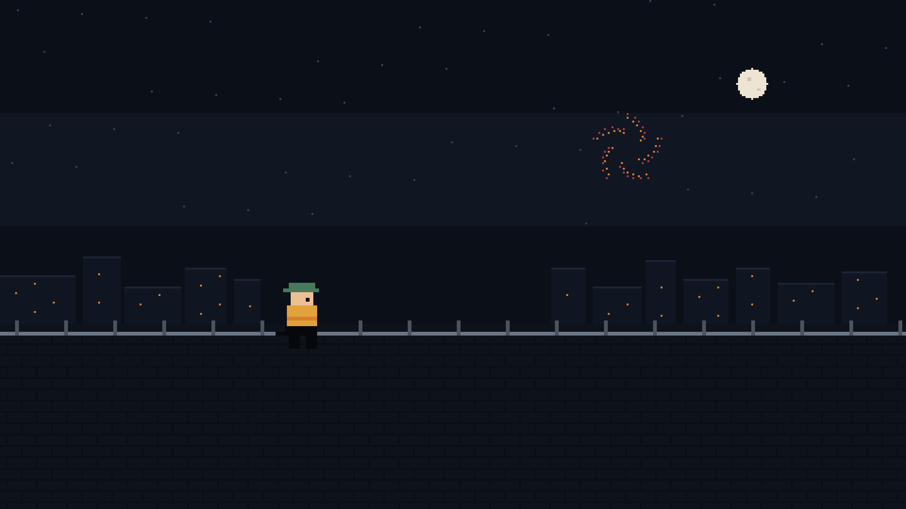

# vibe-pixel-mv

把一首歌做成**像素动画 MV** 的产线技能：固定主角、有限色板、逐帧代码渲染、歌词贴在实物上。
Scenes are written **for this one song** — no stock scene templates.

和 `vibe-knowledge-short`（知识讲解短片）是两套完全独立的技能，不共用外观、不共用脚本。

## 它产出的东西 / What it makes

- 480×270 内部画布，4 倍 nearest 放大到 1920×1080
- 12–16 色色板写死在文件头，全片不临时调色
- 精灵动画 8–12fps 步进（同一帧停 2–4 帧），不做平滑补间
- 中文二值化：小字号绘制 → 阈值化 → 只留纯色像素块
- 光靠抖动点（`(x+y)%2`），不用径向渐变
- 歌词出现在招牌 / 横幅 / 火柴盒 / 拍立得 / 贴纸上，不压正文排版

## 两条硬规矩 / Two hard rules

1. **场景为这首歌现做。** 场景从歌词里的实物、情绪曲线、一个反复出现的母题长出来；街口、路灯、相册这类只能当灵感，不能当模板。
2. **整片都是代码画的。** 不用 AI 生图补背景，不用 ffmpeg 推拉拼切。

## 用法 / Usage

```bash
python scripts/render_mv.py <工程目录> 0   225 s0
python scripts/render_mv.py <工程目录> 225 450 s1
python scripts/render_mv.py <工程目录> 450 675 s2
python scripts/render_mv.py <工程目录> 675 900 s3
python scripts/mux.py <工程目录> <音源> 30 <成片路径> [封面时刻]
```

工程目录里需要有 `index.html` + `film.js`，页面暴露 `window.FPS`、`window.DUR`、`window.READY`，并提供 `seek(t)`。
`mux.py` 需要 ffmpeg：设 `FFMPEG` 环境变量，或装 `imageio-ffmpeg`。

## 范例 / Example

`examples/寂寞烟火-30s/` 是《寂寞烟火》前 30 秒的完整样片工程（四场景 + 片名卡 + 收尾）。
抄做法，别抄场景——换歌必须重写场景函数。



## License

MIT
